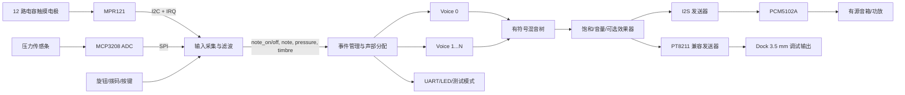

# 基于 Tang Primer 20K 的实时多音色电子乐器项目规划

> 文档版本：v1.0  
> 调研与核查日期：2026-09-17  
> 目标比赛：2026 年全国大学生嵌入式芯片与系统设计竞赛 FPGA 创新设计赛道，高云半导体选题二  
> 当前团队条件：2 人，FPGA/Verilog 经验较少，团队每周按约 20 小时规划，先完成稳定可演奏原型  
> 当前硬件：Sipeed Tang Primer 20K 核心板及 Dock 全功能底板，Dock 具体版本待实物到手后确认

## 1. 结论与推荐路线

本项目建议做成一台 12 键触摸式复音合成器，暂定名为 **PolyTouch FPGA Synth**。第一演奏维度为 12 个电容触摸键，负责选音、触发和和弦；第二演奏维度为压力传感条，负责力度、持续音量或音色明亮度。FPGA 内部采用 DDS 相位累加器、单周期波表、ADSR 包络和并行混音构成纯硬件合成链路，通过标准 I2S 输出到外接 PCM5102A DAC。Dock 板载 PT8211 和 3.5 mm 耳机口保留为前期发声调试通道。

推荐按三个等级推进：第一阶段完成 4 复音、单音色、按键和 ADSR，达到赛题基础线；第二阶段完成 8 复音、两种音色、压力表情和正式 I2S 输出，形成可提交的稳定版本；第三阶段再考虑 32 复音、延迟/合唱效果和频谱显示。两名初学者不应一开始同时开发 32 复音、显示、无线和复杂效果器，否则联调风险会迅速放大。

Tang Primer 20K 使用 GW2A-LV18PG256C8/I7，具有 20,736 个 LUT4、48 个 18×18 乘法器、828 Kbit BSRAM、4 个 PLL、板载 1 Gbit DDR3 和 27 MHz 晶振。对 8 复音波表合成器资源充足；合理压缩波表后也有能力实现 32 个独立相位与包络状态的振荡器。板卡资格已核实：赛题指南第 11 页“自备开发板”明确写明“本次比赛亦支持使用第三方以高云半导体 FPGA 芯片为核心的开发板”；Primer 20K 属于此类，且其 GW2A-LV18 与推荐列表中的 Tang Nano 20K（GW2AR-LV18QN88C8/I7）同属 20K LUT4 的 GW2A-18 器件，可直接作为选题二平台，不需要更换。

## 2. 赛题要求拆解

| 赛题要求 | 项目实现方式 | 验收证据 |
| --- | --- | --- |
| 至少 2 个独立演奏维度 | MPR121 的 12 路电容触摸选音/触发；FSR 压力条连续控制力度或音色 | 同一音高下压力改变音量/亮度，触摸键可独立复音 |
| 纯 FPGA HDL 逐样本合成 | 所有传感器协议、事件管理、DDS、ADSR、混音和 I2S 均用 Verilog 实现 | RTL 层级图、代码、仿真波形、综合报告 |
| 总延迟不超过 10 ms | MPR121 设为 1 ms 采样，短去抖；48 kHz 逐样本处理；无软件任务调度 | 逻辑分析仪同时采集触摸 IRQ 与 I2S 起始，测时间差 |
| 至少 4 复音 | 首个完整版本做 8 个独立声部，最低验收可先启用 4 个 | 同时按下 4/8 键，频谱出现对应独立峰值 |
| 单音实时变调与 ADSR | 每声部独立 32 位相位累加器、频率控制字和四段包络状态机 | 仿真包络曲线，实测变调与释音 |
| 多声部实时混音 | 有符号加法树、位宽扩展、饱和裁剪和固定余量 | 最大复音下无回绕失真，输出波形可观测 |
| I2S 输出至 DAC | 外接 PCM5102A，48 kHz、24 位数据、64 BCK/LRCK | BCK/LRCK/DIN 时序截图和 DAC 实际发声 |
| 禁止预录 PCM | 只存一个周期的数学波形表；不存歌曲或整段声音 | 波表生成脚本/ROM 内容及地址循环方式说明 |
| 现场多振荡器验证 | 测试模式固定开启 4、8 或 32 个不同频率声部 | 音频 FFT、多谱峰照片、综合资源报告 |

单周期波表属于实时波表合成，并不等于播放预录 PCM。答辩时应明确说明：ROM 中只有周期函数采样值，音高由每个声部的相位步进实时决定，起音、包络、混音和输出均逐样本计算。

## 3. 整体系统架构



建议让正式设计主要运行在外部 12.288 MHz 音频时钟域。该频率可整数分频得到 48 kHz 采样使能和 3.072 MHz BCK，避免从板载 27 MHz 近似分频带来的音频时钟误差。MPR121、MCP3208 和低速控制逻辑也可以在 12.288 MHz 下工作，从而省去初学阶段容易出错的跨时钟域处理。板载 27 MHz 只用于兼容官方例程或后续显示扩展。若实际 PMOD 走线不适合接入外部时钟，再改成 27 MHz 系统域加异步事件 FIFO，不能直接把异步传感器信号送入音频逻辑。

## 4. 各功能板块的执行思路

### 4.1 电容触摸键盘

使用一块不带 MCU 的 MPR121 模块连接 12 片铜箔或 PCB 电极。MPR121 通过 I2C 与 FPGA 通信，IRQ 在触摸状态变化时通知 FPGA。FPGA 内建立初始化 ROM 和 I2C 主机状态机，上电后写入滤波、阈值、去抖和电极配置寄存器，再在 IRQ 到来时读取 12 位触摸状态。

初版配置建议把电极采样间隔设为 1 ms，数字去抖取连续 2 次相同状态。这样通常能在 2～4 ms 内得到稳定事件。触摸阈值必须在装好最终面板后重新测量；裸杜邦线、金属外壳和 USB 地线都会改变基线。每个按键输出 `key_down`、`key_up` 和 0～11 的 `key_id`，不要让后级直接读取原始触摸位图。

第一版把 12 键映射为一个八度的半音阶。拨码或旋钮选择基准八度；后续可增加“和弦模式”，让一个触摸键同时产生根音、三度和五度，以稳定展示复音能力。

### 4.2 压力表情控制

使用一条 FSR 压力传感器与固定电阻构成分压，接入 MCP3208 的一个模拟通道。MCP3208 是 12 位、8 通道 SPI ADC，可为后续多压力垫预留通道。FPGA 用 1～2 MHz SPI 时钟循环采样，初版有效更新率设为 1 kHz。

ADC 数据先做 4 点中值或限幅，再用一阶 IIR 平滑：`y[n] = y[n-1] + (x[n]-y[n-1])/8`。按下瞬间的压力值映射为 velocity，持续压力映射为 aftertouch，可控制包络峰值、总音量或两个波表之间的混合。初版只控制音量最容易听出效果；第二版再控制音色亮度。

FSR 不是高精度测力元件，个体差异和机械安装影响很大。设计目标应是稳定、可表现的相对力度，不应追求牛顿级准确度。FSR 与 ADC 之间建议加入简单 RC 滤波，并保证模拟地与数字地连接短而稳定。

### 4.3 事件管理和声部分配

输入层统一输出以下事件结构：

```text
event_valid
event_type   : NOTE_ON / NOTE_OFF / CONTROL
note_id      : 0..127
velocity     : 0..4095
pressure     : 0..4095
timbre_id    : 0..1
```

声部分配器维护每个 voice 的 `active`、`note_id`、`age` 和包络状态。收到 NOTE_ON 时，优先选择空闲声部，其次选择已经进入 RELEASE 且幅度最低的声部，最后才窃取最老声部。NOTE_OFF 只让对应声部进入 RELEASE，不立即清零，这样声音不会产生爆音。首版可以使用固定的 8 声部数组和优先编码器，不需要软核 CPU。

### 4.4 DDS 振荡器与波表

每个独立声部包含一个 32 位相位累加器：

```text
phase[n+1] = phase[n] + phase_inc
phase_inc  = round(f_note × 2^32 / Fs)
```

`phase_inc` 由音符查找表给出，`phase[31:24]` 作为 256 点波表地址。256 点波表配合 32 位相位累加器已经能得到足够精细的音高；高音区的波形失真和混叠可以在后续用多级波表改善。

首版准备两种单周期音色：正弦/长笛类波形，以及含有限谐波的风琴/弦乐类波形。每个声部复制一份 2×256×16 bit ROM，使 8 或 32 个声部可以同一个采样周期并行读取。32 声部时约占 262 Kbit 波表存储，低于 828 Kbit BSRAM 总量。避免直接使用锯齿波满带宽查表，因为其高音混叠会非常明显。

### 4.5 ADSR 包络与表情

每个声部使用 IDLE、ATTACK、DECAY、SUSTAIN、RELEASE 五态状态机，包络幅度使用 16 位无符号定点数。每个 48 kHz 样本更新一次包络，步进值由预计算寄存器给出，不在实时路径中做除法。推荐默认值为 Attack 5～15 ms、Decay 80～150 ms、Sustain 60%～80%、Release 150～300 ms。

压力值在 NOTE_ON 时决定包络峰值，持续压力可缓慢改变峰值目标。将 velocity 和 aftertouch 先合成为一个 16 位幅度系数，再只做一次 `wave × amplitude` 乘法，可以使每个声部只消耗一个 18×18 DSP。8 声部预计使用 8 个乘法器；32 声部预计使用 32 个，仍在器件 48 个乘法器的范围内。

### 4.6 混音、位宽和削波

16 位波形乘以 16 位幅度得到约 32 位有符号结果。8 声部求和至少增加 3 位，32 声部增加 5 位。混音树每一级都保持扩展位宽，最后先做固定衰减，再进行对称饱和裁剪，严禁直接截取高位造成回绕失真。

初版可以固定按 8 声部留出余量。优化版可根据活跃声部数量选择 1、1/2、1/4、1/8 或 1/16 增益。软限幅、合唱和延迟属于加分项，必须在基础混音没有爆音、直流偏置和溢出的前提下加入。

### 4.7 I2S 和板载音频输出

正式输出使用 PCM5102A 模块，配置为 48 kHz、24 位有效数据、每声道 32 个 BCK，即 BCK=3.072 MHz、LRCK=48 kHz。PCM5102A 可使用 BCK 内部 PLL，不强制提供 MCLK；模块的 FMT 引脚应选择标准 I2S。PCM5102A 输出是线路电平，建议连接有源音箱，若要直接带无源扬声器需另加功放。

Dock 板载音频通路为 PT8211-S 加 LPA4809MSF 耳机功放。PT8211 使用右对齐/Japanese 格式，并非标准 I2S。它可以复用官方例程快速验证波表、包络和混音，但不能作为赛题中“I2S 接口输出至 DAC”的唯一证据。板载音频固定信号为 `HP_DIN=P15`、`HP_WS=P16`、`HP_BCK=N15`、`PA_EN=R16`；正式 PCM5102A 应从一个 PMOD 引出独立的 BCK、LRCK、DIN 和 GND。

### 4.8 调试与现场测试模式

设计中应保留一个硬件测试模式，由拨码开关或长按按键进入。测试模式绕过传感器，自动开启 4、8 或 32 个固定频率声部，例如 261.63、329.63、392.00、523.25 Hz 等。UART 每秒输出活跃声部数、触摸位图、ADC 值、削波计数和模式编号；LED 显示初始化、运行、错误和削波状态。

现场验证准备三类证据：逻辑分析仪截图证明 IRQ 到首个非零 I2S 样本的时间；频谱图证明同时存在对应数量的独立谱峰；Gowin 综合报告和 RTL 代码证明每个声部具有独立相位累加器、频率和包络状态。

## 5. 模块接口与工程层级

建议采用如下 RTL 层级。模块间只通过同步事件或逐样本数据连接，避免某个模块直接读取另一个模块的内部寄存器。

```text
top
├─ clock_reset
│  ├─ audio_clock_input / divider
│  └─ power_on_reset
├─ input_frontend
│  ├─ i2c_master
│  ├─ mpr121_init_readout
│  ├─ spi_master
│  ├─ mcp3208_sampler
│  ├─ pressure_filter
│  └─ key_event_encoder
├─ event_router
│  ├─ note_mapper
│  └─ voice_allocator
├─ synth_engine
│  ├─ phase_increment_rom
│  ├─ voice[0..N-1]
│  │  ├─ phase_accumulator
│  │  ├─ wavetable_rom
│  │  ├─ adsr
│  │  └─ amplitude_multiplier
│  └─ signed_mixer_tree
├─ audio_output
│  ├─ master_gain_saturator
│  ├─ i2s_tx
│  └─ pt8211_tx_debug
└─ diagnostics
   ├─ test_tone_generator
   ├─ uart_tx
   └─ status_leds
```

核心握手建议统一为 `valid/ready`。音频链内部使用全局 `sample_tick`：所有 voice 在同一个 tick 更新相位和包络，混音结果在固定若干时钟后送入输出寄存器。需要明确记录流水线延迟，并让 I2S 在每个新采样周期只取一次已稳定的混音值。

建议工程目录如下：

```text
rtl/common/       时钟、复位、定点工具、UART
rtl/input/        I2C、MPR121、SPI、MCP3208、滤波
rtl/synth/        音符表、voice、ADSR、波表、混音
rtl/audio/        I2S、PT8211、饱和器、可选效果器
rtl/top/          顶层与模式控制
constraints/      按 Dock 版本区分的 CST/SDC
sim/              各模块和系统 testbench
gowin/            gprj、IP 配置与构建 Tcl
docs/             架构、测试记录、综合报告和答辩材料
tools/            生成波表、频率字和构建辅助工具
```

## 6. 硬件连接原则

Dock 3714 与 3713 的主要已知差异包括 DVI 优化以及 SW0/KEY4 管脚互换。板卡尚未到手，因此当前不锁定外接模块的 FPGA 管脚号。收到实物后先查看底板背面或丝印版本，再从对应官方原理图建立 `constraints/dock_3713.cst` 或 `constraints/dock_3714.cst`。音频固定引脚在两版原理图中一致。

建议按接口分组连接：

| 接口组 | FPGA 侧信号 | 外设侧信号 | 注意事项 |
| --- | --- | --- | --- |
| PMOD-A：正式音频 | `i2s_bck, i2s_lrck, i2s_dout` | PCM5102A `BCK, LCK/LRCK, DIN` | 共地、3.3 V 逻辑；DAC 输出接有源音箱 |
| PMOD-A：音频时钟 | `audio_clk_12m288` | 12.288 MHz 3.3 V CMOS 有源晶振输出 | 优先选择可走全局时钟的引脚；最终以 PnR 报告确认 |
| PMOD-B：触摸 | `i2c_scl, i2c_sda, touch_irq_n, touch_rst_n` | MPR121 对应引脚 | SDA/SCL 需要合适上拉；确认模块是否已带上拉 |
| PMOD-C：压力 ADC | `adc_sck, adc_mosi, adc_miso, adc_cs_n` | MCP3208 SPI | ADC 供电、参考和 FPGA 电平统一为 3.3 V |
| 板载调试音频 | `HP_BCK, HP_WS, HP_DIN, PA_EN` | Dock PT8211/LPA4809 | 使用右对齐格式；PA_EN 上电延迟后再拉高以减少爆音 |
| 调试 | `uart_tx`、LED、拨码 | BL702 UART、板载 LED/开关 | BL702 只作下载器/串口，不参与演奏和音频计算 |

不要将板载按键默认视为全部 3.3 V 逻辑；原理图中部分按键网络涉及 1.5 V。收到板卡并核对版本前，优先使用外接 PMOD 输入。所有外部信号先确认 I/O Bank 电压，再写 CST 的 `IO_TYPE`。

## 7. 建议采购清单

| 器件 | 建议数量 | 用途 | 优先级 |
| --- | ---: | --- | --- |
| PCM5102A I2S DAC 模块 | 1～2 | 正式标准 I2S 音频输出，备用一块便于排故 | 必需 |
| 12.288 MHz、3.3 V CMOS 有源晶振模块 | 1～2 | 产生精确 48 kHz 系列音频时钟 | 强烈建议 |
| MPR121 电容触摸模块 | 1～2 | 12 路触摸键盘 | 必需 |
| 铜箔胶带、亚克力/木板面板、导线 | 若干 | 制作 12 键演奏面板 | 必需 |
| FSR 压力传感器或压力条 | 2～3 | 力度/aftertouch，留备件 | 必需 |
| MCP3208 12 位 SPI ADC | 1～2 | FSR 模拟采集及后续扩展 | 必需 |
| 1% 电阻包、100 nF/1 µF 电容 | 若干 | FSR 分压、滤波、去耦和 I2C 上拉 | 必需 |
| PMOD 排针/转接板、杜邦线、短排线 | 若干 | 稳定连接外设，最终应焊接固定 | 必需 |
| 有源音箱 | 1 | 接收 PCM5102A 线路输出 | 必需 |
| USB 逻辑分析仪（至少 24 MHz） | 1 | 测 I2C、SPI、I2S 和端到端延迟 | 强烈建议 |
| 示波器或可借用实验室示波器 | 1 | 检查时钟、电源、模拟输出和爆音 | 建议 |
| 旋转编码器和少量独立按键 | 若干 | 八度、音色和 ADSR 参数选择 | 可选 |
| 小型 OLED/SPI LCD | 1 | 后期显示参数，不进入首版关键路径 | 可选 |

如果 12.288 MHz 模块不易购买，可以先用 Dock 板载 PT8211 和官方近似时钟完成合成器开发，再切换正式 I2S 时钟。不要为了省掉一颗时钟模块而在比赛版本中留下不可解释的采样率误差和较大抖动。

## 8. 资源与性能预估

| 配置 | DSP | 波表 BSRAM 估算 | 吞吐指标 | 定位 |
| --- | ---: | ---: | ---: | --- |
| 4 voice × 48 kHz | 约 4 | 约 32 Kbit | 192 k oscillator-samples/s | 最低验收 |
| 8 voice × 48 kHz | 约 8 | 约 64 Kbit | 384 k oscillator-samples/s | 推荐提交基线 |
| 32 voice × 48 kHz | 约 32 | 约 262 Kbit | 1.536 M oscillator-samples/s | 拓展目标 |

以上按每声部一个幅度乘法器、两种 256×16 bit 波表估算。实际 Gowin 映射会受到 ROM 写法和综合选项影响，每次增加声部数后都必须检查 DSP、BSRAM、时序和功耗报告。32 声部时仍需给控制逻辑、效果器和调试留余量，因此不建议为线性插值再给每声部增加乘法器。

48 kHz 下一个采样周期约 20.83 µs。即使使用 12.288 MHz 主时钟，一个采样周期也有 256 个系统时钟，足够完成控制更新、加法树和输出装载。真正的端到端延迟主要来自触摸传感器扫描与去抖，不来自 DDS 运算。

预估延迟如下：

| 环节 | 目标延迟 |
| --- | ---: |
| MPR121 扫描、IRQ 和两次去抖 | 2～4 ms |
| I2C 读取及事件编码 | 小于 0.5 ms |
| 等待下一个音频样本 | 小于 0.021 ms |
| DDS、包络和混音流水线 | 小于 0.01 ms |
| PCM5102A 数字滤波 | 低延迟模式约 0.073 ms（3.5 个样本）；普通模式约 0.42 ms（20 个样本） |
| 预计总延迟 | 约 3～5 ms，留足赛题 10 ms 余量 |

该数值属于设计预算。采购模块时应确认 FLT/滤波模式引脚能否配置；即使使用普通滤波模式，预计总延迟仍低于 5 ms。最终结论必须用硬件实测替代估算。

## 9. 两人七周执行计划

比赛材料给出的作品提交时间为 **2026-11-04 18:00**。从 2026-09-17 起按七周、团队合计约 20 小时/周规划，总量约 140 小时。若 20 小时是每人投入，则多出的时间优先用于测试、结构件和答辩材料，不提前扩大功能范围。

| 周次 | 目标与工作 | A 同学主责 | B 同学主责 | 周末验收 |
| --- | --- | --- | --- | --- |
| 第 1 周 9/17～9/23 | 工具链、Verilog 基础、时钟和 PT8211 发声 | Gowin 工程、计数器、波表/DDS | 板卡资料、PT8211、逻辑分析仪 | 下载码流后稳定输出单音，能解释 BCK/WS/DIN |
| 第 2 周 9/24～9/30 | 标准 I2S 和 PCM5102A；单 voice ADSR | I2S TX、时钟约束、饱和输出 | ADSR 仿真、DAC 接线、声音测试 | 48 kHz I2S 单音，按测试按钮有起音和释音 |
| 第 3 周 10/1～10/7 | MPR121 驱动和 12 键事件 | I2C 主机、初始化 FSM | 电极面板、阈值测量、UART 状态 | 12 键无明显串键，按下/松开事件稳定 |
| 第 4 周 10/8～10/14 | 4/8 复音、分配器和混音 | voice 数组、分配器、加法树 | 多键测试、频谱和削波测试 | 同时 8 键可闻，NOTE_OFF 和偷音策略正常 |
| 第 5 周 10/15～10/21 | FSR+MCP3208 和第二音色 | SPI ADC、数字滤波、表情映射 | FSR 机械结构、校准、音色切换 | 力度连续可控，两种音色可切换，延迟初测 |
| 第 6 周 10/22～10/28 | 稳定性、测试模式、可选 32 复音 | 时序/资源优化、测试模式 | 长时间演奏、EMI/接触不良排查、外壳 | 连续运行 1 小时无死机，4/8 谱峰证据齐全 |
| 第 7 周 10/29～11/3 | 冻结功能、文档、视频和备份 | 整理 RTL/综合报告/版本标签 | 演示脚本、拍摄、答辩问题、备用线材 | 11/3 完成提交包，11/4 只做复核和上传 |

两人都必须能独立完成下载、进入测试模式和说明信号链。A/B 主责用于提高效率，不代表模块只能由一个人理解。每周至少安排一次 30 分钟集成评审，记录本周可复现版本、失败现象和下一步验收条件。

## 10. 开发和验证方法

每个模块按“仿真通过 → 单模块上板 → 接入系统”的顺序完成。优先编写以下 testbench：相位累加器音高误差、ADSR 状态转换、声部偷取、8/32 路最坏值混音、I2S 帧格式、MPR121 I2C 寄存器读写和 MCP3208 SPI 帧。测试输入应覆盖复位中断、连续快速按键、同音重复触发、全部声部占满、最大正负样本和突然断开传感器。

每个可演示里程碑保留以下文件：对应 Git 提交或压缩包、`.fs` 码流、综合/PnR 报告、CST/SDC、测试步骤、实测截图和已知问题。不要只保存能运行的码流而丢失生成它的源码和约束。

正式验收建议使用下列门槛：

1. 上电后 3 秒内进入可演奏状态，初始化失败有明确 LED/UART 指示。
2. 连续快速演奏 10 分钟无卡死、挂音和随机重启。
3. 4 键同时按下时频谱存在 4 个独立基频峰；8 声部作为项目基线。
4. 触摸 IRQ 到 I2S 非零样本实测小于 5 ms，最坏情况仍小于 10 ms。
5. 最大复音时无数字回绕，削波计数在正常演奏下接近 0。
6. 断开某个传感器后系统仍可进入测试模式并发声。
7. 重新拉取工程后，使用固定 Tcl 构建能生成相同目标器件的码流。

## 11. 主要风险和规避措施

| 风险 | 影响 | 处理方式 |
| --- | --- | --- |
| Primer 20K 未列在选题二明确适配清单中 | 参赛资格或答辩时被质疑 | 立即向官方群提交板卡型号与芯片型号确认；引用“支持自备高云 FPGA 板卡”条款 |
| 把板载 PT8211 当成 I2S DAC | 不满足赛题接口表述 | PT8211 只用于调试，提交版本使用 PCM5102A 标准 I2S |
| Dock 版本未知 | 按键和扩展引脚约束可能错误 | 到货先确认 3713/3714，再生成对应 CST；当前不锁死 PMOD 管脚 |
| MPR121 串键或漂移 | 乐器不可演奏、延迟不稳定 | 最终结构下重新调阈值；缩短电极线；数字去抖；保存原始/基线调试数据 |
| FSR 噪声和非线性 | 力度跳变 | RC 滤波、中值+IIR、死区和上下限校准；按相对值使用 |
| 27 MHz 无法方便整数生成标准 48 kHz 时钟族 | I2S 采样率误差、DAC 不锁定 | 使用 12.288 MHz 外部有源晶振；PnR 检查时钟路由 |
| 一开始追求 32 复音/效果器 | 延误基础功能 | 以 8 复音冻结提交基线；基础验收后通过参数化 `VOICE_COUNT` 扩展 |
| 新手只在顶层边写边调 | 难以定位错误 | 小模块 testbench、固定接口、每周一个可回退里程碑 |
| BL702 被用于演奏控制 | 纯硬件属性受质疑 | BL702 仅用于 JTAG/UART，功能链图中明确排除 MCU |

## 12. Gowin、Codex 和 VS Code 工作流现状

GitHub 上存在第三方 Gowin MCP 项目。已选用 [jgpeiro/gowin_mcp_server](https://github.com/jgpeiro/gowin_mcp_server)，因为它通过高云官方 `gw_sh.exe` Tcl 接口提供新建工程、添加文件、综合、布局布线和完整构建工具。项目已下载至 `tools/vendor/gowin_mcp_server`，并针对本机 Gowin Education V1.9.11.03 路径和 Windows 后台进程做了小幅适配。该项目不是高云官方产品，使用的后端 `gw_sh.exe` 是本机高云官方工具。

已完成真实 MCP stdio 测试：服务初始化成功、可启动/停止 Gowin shell、可执行 Tcl；还以目标器件 `GW2A-LV18PG256C8/I7`、器件版本 `C` 完成了最小工程综合、布局布线和 `.fs` 码流生成。测试证据保存在 [docs/evidence/gowin-mcp-smoke.json](../../evidence/2026/10/gowin-mcp-smoke.json)，复测命令为：

```powershell
& '.\tools\.venv-gowin-mcp\Scripts\python.exe' '.\tools\check_gowin_mcp.py' --build
```

项目级 MCP 配置已经写入 `.codex/config.toml`，可移植模板为 [tools/gowin-mcp.config.toml](../../tools/gowin-mcp.config.toml)。OpenAI 官方文档说明 Codex 桌面端、CLI 和 IDE 扩展共享 MCP 配置，但当前这台机器的受管 Codex 策略把自定义 MCP 标记为 `disabled: requirements`，因此本次会话无法直接显示 Gowin MCP 工具。配置与服务本身已通过独立 MCP 客户端和实际 Gowin 构建验证；若以后解除该策略，重启 Codex/VS Code 扩展即可加载。

还检索到两个相近项目：[Papipapito/gowin-mcp](https://github.com/Papipapito/gowin-mcp) 主要解析 Gowin 构建报告，不能控制 IDE 完成构建；`gw-synth-flash-mcp` 能运行 Tcl 和下载码流，但当前目标系统为 macOS，不适合这台 Windows 电脑。

在受管策略解除前，按用户要求通过 VS Code 同步开发。工作区文件为 [FPGA-Instrument.code-workspace](../../FPGA-Instrument.code-workspace)，推荐流程如下：

1. 在 VS Code/Codex 中编辑 Verilog、CST、SDC、测试和文档，所有内容都位于本项目目录。
2. 用 `gw_sh.exe build.tcl` 或上述检查脚本执行可重复的命令行构建。
3. 需要查看 IP Core、FloorPlanner、GAO 或 Programmer 时打开 Gowin 图形界面，并指向同一个 `.gprj`。
4. 下载到板卡前先检查 PnR 报告中的器件、CST 管脚、Bank 电压和时序；硬件下载保留为人工操作。
5. 每次稳定演示后提交 Git 或制作带日期的只读归档，同时保存 `.fs` 和报告。

## 13. 第一阶段立即执行清单

板卡到货前可以并行完成 Verilog 学习、DDS/ADSR/I2S 仿真、MPR121 和 MCP3208 模块采购、触摸面板草图以及答辩指标表。板卡到货当天按以下顺序操作：确认核心板和 Dock 版本；检查 1 号拨码是否使能核心板；运行官方 LED/串口示例；运行 PT8211 官方示例；记录板载时钟和复位；建立本项目 CST；再下载本项目最小设计。

第一个冻结里程碑只包含：测试按键触发一个 DDS 正弦、完整 ADSR、板载 PT8211 发声和 UART 状态。第二个里程碑换成 PCM5102A 标准 I2S。第三个里程碑接入 MPR121。这样每增加一个模块都有已知正常的下游音频链作为参照。

## 14. 资料来源

本规划以用户提供的《FPGA创新设计赛道通知.pdf》和《高云半导体.pdf》为比赛要求原始依据，并核对了以下资料：

- [Sipeed Tang Primer 20K 官方 Wiki](https://wiki.sipeed.com/hardware/zh/tang/tang-primer-20k/primer-20k.html)
- [Sipeed Tang Primer 20K 官方示例仓库](https://github.com/sipeed/TangPrimer-20K-example)
- [Sipeed Tang Primer 20K 数据手册](https://dl.sipeed.com/fileList/TANG/Primer_20K/01_Specification/Sipeed%20Tang%20Primer%2020K%20Datasheet%20V1.0.pdf)
- 项目内保存的 [Dock 3714 原理图](../references/boards/Tang_Primer_20K_Dock_3714/Tang_Primer_20K_Dock_3714_Schematics.pdf)、[Dock 3713 原理图](../references/boards/Tang_Primer_20K_Dock_3714/Tang_Primer_20K_Dock-3713_Schematics.pdf) 和 [核心板原理图](../references/boards/Tang_Primer_20K_Dock_3714/Tang_Primer_20K_SOM-3961_Schematic.pdf)
- [高云云源软件教育版与支持器件](https://www.gowinsemi.com.cn/university/software)
- [PCM5102A 官方资料](https://www.ti.com/product/PCM5102A)
- [PT8211 官方资料](https://www.princeton.com.tw/en-us/Products/Multi-Media-Audio/Digital-to-Analog-Converter/DTAC-PT8211)
- [MCP3208 官方资料](https://www.microchip.com/en-us/product/mcp3208)
- [MPR121 官方资料](https://www.nxp.com/products/MPR121)
- [Codex MCP 官方配置说明](https://learn.chatgpt.com/docs/extend/mcp?surface=cli)
- [已适配的 Gowin MCP 项目](https://github.com/jgpeiro/gowin_mcp_server)

所有板卡固定管脚都应在实物版本确认后，以对应 Sipeed 原理图、CST 和一次成功 PnR 报告三者交叉核对。比赛规则和时间若有更新，以竞赛官网与官方群最新通知为准。
